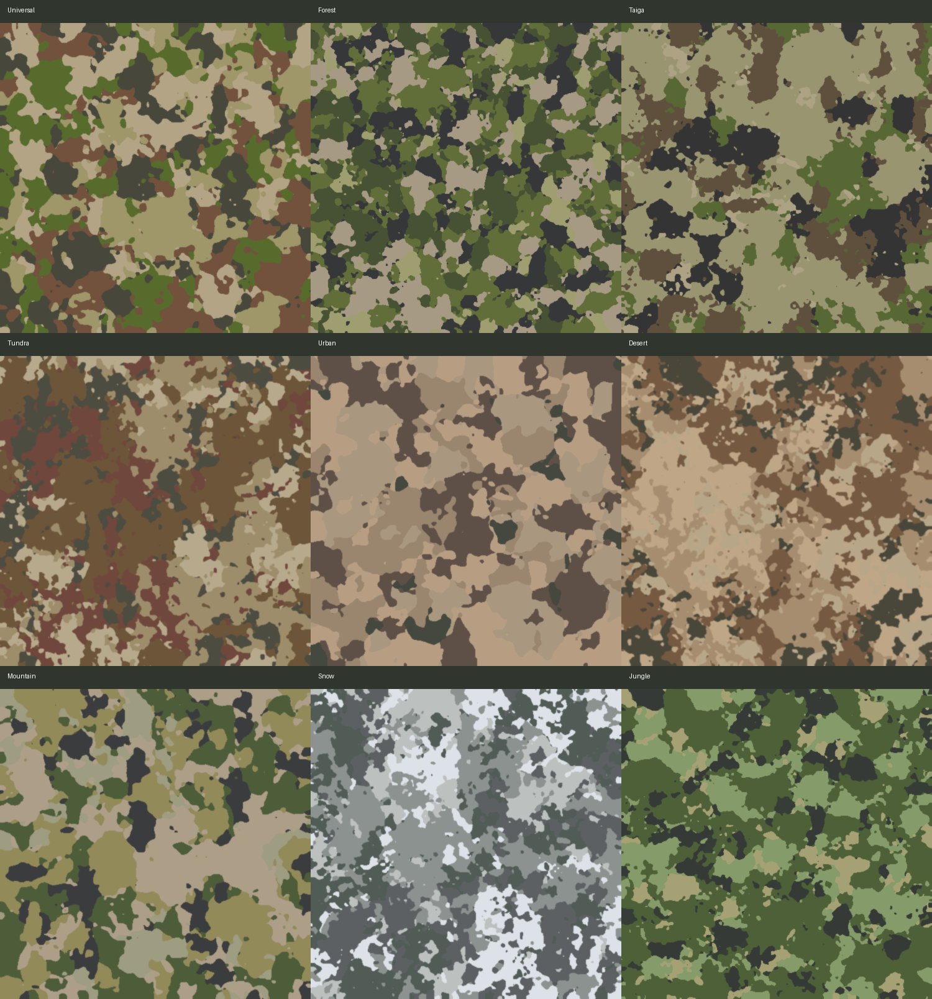
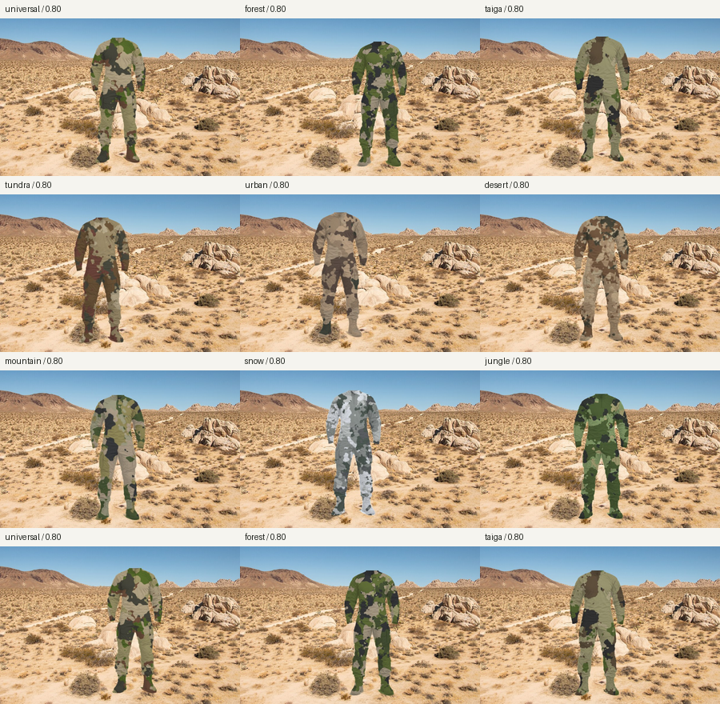

# Camo

An explainable Python prototype that generates camouflage-like patterns from reference landscape photographs.



The repository contains a working procedural baseline, reproducible evaluation
tools, and an incremental roadmap toward neural input analysis. It is designed
to be easy to run as a demo while keeping experimental results and limitations
visible.

## Quick demo

From a fresh clone:

```bash
python3 -m venv .venv
source .venv/bin/activate
python -m pip install -r requirements.txt
python demo.py
```

The demo uses the reference photos already stored in `photos/`, generates five
color patterns, and writes a contact sheet to
`output/demo/all_patterns_grid.png`. It does not require the optional neural
dependencies or a Hugging Face account.

For a visual comparison of the optimized patterns and uniform mockups, see
the generated [optimized pattern grid](output/optimized_final/all_optimized_patterns_grid.png)
and [optimized uniform contact sheet](output/optimized_mockups/outfit_contact_sheet.png).

## Visual results and validation examples

The repository includes representative images so that a visitor can understand
the complete workflow without opening every individual output folder.

### 1. Generated camouflage patterns

This grid contains the final optimized pattern for each supported environment.
Each tile is a 500x500 PNG using the selected industrial color count.


The underlying files are available in
[output/optimized_final/](output/optimized_final/), with one
`optimized_pattern.png` and one `optimizer_report.json` per environment.

### 2. Patterns applied to a complete uniform

These mockups apply the generated patterns to a headless combat uniform with
shirt, cargo trousers, boots, folds, seams, and lighting preserved. They are
useful for judging visual scale and distribution, but they are not production
patterns or a substitute for a physical fabric test.


The individual mockups are stored in
[output/optimized_mockups/](output/optimized_mockups/).

### 3. Patterns tested on environmental backgrounds

The evaluator composites the uniform over photographs from the selected
environment and records a visibility proxy. The following examples show the
kind of scene contact sheets produced during validation:




The complete set is in [output/optimized_validation/](output/optimized_validation/)
and the machine-readable and human-readable summaries are in the corresponding
evaluation output folders. Lower proxy visibility is better within the same
controlled experiment, but the score is not a validated measure of real-world
concealment.

### 4. Reproducible validation procedure

The recommended workflow is:

1. Generate or select the environment-specific and Universal patterns.
2. Run the optimizer on a training subset of backgrounds.
3. Evaluate the selected patterns on held-out backgrounds that were not used
   during optimization.
4. Inspect the contact sheets for obvious artifacts such as oversized shapes,
   repeated placement, sky/water contamination, or unnatural contrast.
5. Run the blinded human-recognition test and analyze detection rate and
   response time.

For a quick local validation run:

```bash
python evaluate_camo.py \
  --pattern-root output/optimized_final \
  --pattern-name optimized_pattern.png \
  --output output/optimized_validation \
  --limit 10
```

The protocol for preparing and analyzing the human test is documented in
[docs/HUMAN_TEST_PROTOCOL.md](docs/HUMAN_TEST_PROTOCOL.md). This separation
between visual inspection, held-out image evaluation, and human recognition
helps avoid treating a single attractive image as proof that a camouflage
pattern is effective.

## Project status

The current release is a research prototype. The procedural generator and
explainable optimizer are usable now; the optional SegFormer component is a
pretrained neural model used to improve input masks. The project does not yet
train a custom neural network or claim operational concealment performance.
The planned neural work is documented in
[docs/NEURAL_ROADMAP.md](docs/NEURAL_ROADMAP.md).

The program:

- extracts a representative color palette;
- excludes likely sky and water pixels;
- analyzes luminance and texture at three scales;
- measures directional bias, transitions, and fine-edge density to reject weak shapes;
- generates several procedural patterns;
- ranks candidates and saves the best pattern for each environment.

This is an experimental image-statistics tool, not a guarantee of real-world concealment.

## What this project demonstrates

- procedural image generation from real reference photographs;
- palette extraction and environment-specific style profiles;
- optional semantic segmentation with a pretrained vision model;
- explainable search-based optimization;
- reproducible train/test evaluation;
- image-based and human recognition testing.

## Project layout

```text
photos/
├── forest/
├── mountain/
├── taiga/
├── tundra/
├── jungle/
├── desert/
├── urban/
├── snow/
└── other/

evaluation/
├── backgrounds/              # balanced online/local photos grouped by environment
├── sources.json               # download and license metadata for starter images
└── SOURCES.md

output/
├── universal/
├── forest/
├── mountain/
├── taiga/
├── tundra/
├── jungle/
├── desert/
├── urban/
├── snow/
├── other/
├── all_patterns_grid.png
├── report.json
├── validation_report.json
├── validation_report.md
├── summary_grid.json
├── evaluation/                # background composites, metrics, and human-test scenes
└── segmentation_masks/       # created only when semantic segmentation is used

src/camo/                     # reusable project metadata and the migration target for core modules
tests/                        # fast regression tests
scripts/                      # repeatable experiment helpers
configs/                      # versioned experiment settings
docs/                         # protocols and project documentation
```

The original root command files remain available so existing commands continue
to work while the implementation is migrated incrementally into `src/camo/`.

The `universal` pattern uses all non-snow reference images and gives every non-snow environment group equal weight, regardless of how many pixels or photographs it contains. Snow references are deliberately excluded from Universal because their very bright palette would make the mixed pattern less useful for the other environments. Taiga, tundra, and jungle references are included because they represent useful non-snow environments. Environment-specific patterns use only images in the corresponding group. Urban images contribute to both `urban` and `universal` outputs; snow images contribute only to `snow`.

Each environment uses a small style profile. Forest, taiga, and jungle patterns preserve more fine detail and use smaller, denser organic blobs. Desert patterns use larger, broader regions with a flatter aspect ratio. Mountain and tundra patterns use medium-to-large irregular regions, urban patterns use more elongated fragmented shapes, and snow patterns use larger cold regions with strong contrast. The selected profile is recorded in each group's `report.json`.

The universal palette reserves one matte forest-green color when forest references are available. This keeps green visible in the mixed environment result without allowing bright or saturated colors to dominate. Palette colors are gently anchored to Fosco-style matte military tone families: Olive Drab, NATO Green, Service/Mud Brown, Tropentarn Sand, and NATO Black. These are approximate style references, not exact colorimetric reproductions of a specific product.

Universal output also balances the effective pixel coverage of the palette. After generating the competing regions, the script calibrates their area so that one color cannot become an oversized background by chance.

The generator deliberately does not copy directional high-frequency texture from source photos. It combines competing smooth fields with blurred organic blob fields at several scales: large regions break the silhouette, medium regions create transitions, and small regions add controlled detail. Adjacent regions can share boundaries and merge instead of producing only isolated islands inside one background color. The candidate score also applies a small penalty to strongly directional or excessively fragmented structures, which helps reject stripe-like results.

## Installation

```bash
python3 -m venv .venv
source .venv/bin/activate
python -m pip install -r requirements.txt
```

Run the fast regression tests with:

```bash
python -m unittest discover -s tests -v
```

The neural input stage is optional. Install its dependencies only when needed:

```bash
python -m pip install --timeout 600 --retries 10 -r requirements-ml.txt
```

## Usage

Run the default 500x500 generation:

```bash
python camo.py --input photos --output output
```

When started without `--mode`, the terminal asks whether to use `standard`, `custom`, or `optimized` mode. Choosing `standard` preserves the current generator behavior and defaults. Choosing `custom` asks for pattern density, the maximum Universal color share, the Universal green share, and the dark-color share. Choosing `optimized` applies the best configuration found by the current benchmark: semantic input segmentation, high pattern density, and five colors. Explicit CLI values still take precedence. All prompts and generated reports are in English.

Run the benchmark-selected configuration with:

```bash
python camo.py --mode optimized --device cpu --save-segmentation-masks
```

The optimized mode is based on the project's internal diagnostics, not on a
validated field concealment test. It should be treated as the recommended
experimental default until printed and real-scene evaluations are available.

The same custom settings can be supplied without interactive prompts:

```bash
python camo.py --mode custom --density high --max-color-share 0.30 --green-share 0.22 --dark-share 0.10
```

Available density levels are `low`, `standard`, and `high`. The color-share values are fractions from `0.00` to `1.00`, for example `0.22` means 22% of the Universal output. The color count can still be selected with `--colors 2` through `--colors 5`.

The default palette contains 5 colors, which is suitable for a first industrial-style test. When running interactively, the program asks for the number of colors; pressing Enter keeps 5. The supported range is 2 to 5 colors. The default pattern now uses denser shape scales, so more distinct spots remain visible in the 500x500 output.

You can also select the number directly from the command line:

```bash
python camo.py --colors 3
```

## Optional neural input segmentation

The generator can use a pretrained SegFormer semantic segmentation model before computing image statistics. It predicts a class for each pixel and removes likely sky, water, people, vehicles, and animals from the reference evidence. Manual masks still have priority, and the existing color-based filter remains as a safety fallback.

Run it explicitly with:

```bash
python camo.py --mode standard --segmentation semantic --save-segmentation-masks
```

The default model is `nvidia/segformer-b0-finetuned-ade-512-512`. Its weights are downloaded and cached on the first run. On Apple Silicon, `--device auto` uses MPS when available; use `--device cpu` for a compatibility fallback. Neural masks are saved under `output/segmentation_masks/` when `--save-segmentation-masks` is provided, and each group report records the mask source and labels detected in the input images.

The ML environment includes both `torch` and `torchvision`; they must be installed as a compatible pair because Transformers uses `torchvision` for the SegFormer image processor. A Hugging Face token is optional for this public model; the unauthenticated warning only indicates lower download limits.

The neural stage improves input selection; it does not generate the camouflage pattern itself and it is not a guarantee of real-world concealment. Validate the masks visually before relying on them for new image types.

Increase the search effort while keeping the industrial five-color limit:

```bash
python camo.py --candidates 300 --colors 5
```

## Configuration benchmark

Use `benchmark.py` to compare controlled combinations of density, palette size,
random seed, and optional semantic segmentation. The default benchmark tests
the three density levels with 3 and 5 colors, using 16 candidates per group.
It writes a ranked JSON/Markdown report and a Universal contact sheet under
`output/benchmark/`.

```bash
python benchmark.py --segmentation none --clean
```

After installing the optional ML dependencies, compare the automatic mask and
the neural mask in one run:

```bash
python benchmark.py --segmentation both --device cpu --clean
```

For a faster smoke test:

```bash
python benchmark.py --densities standard --colors 5 --candidates 4 --clean
```

The benchmark score is an internal diagnostic for color, luminance, texture,
and shape structure. It is useful for comparing code changes, but it is not a
measurement of real-world concealment.

## Outfit mockups

Generate realistic headless full-uniform visualizations from the exact generated
patterns. Each mockup uses a neutral product-photography reference with a
combat shirt, cargo trousers, and combat boots. The pattern is composited over
the extracted garment surface while preserving folds, seams, pockets, and
volume shading. The result is a visual comparison aid, not a manufacturing
template.

```bash
python generate_outfit_mockups.py
```

The default output contains Universal, Desert, Mountain, Snow, and Jungle
mockups plus a contact sheet under `output/outfit_mockups/`. Other groups can be
selected explicitly:

```bash
python generate_outfit_mockups.py --groups universal,forest,taiga,tundra,urban
```

To visualize patterns produced by the optimizer, point the script at its
output directory and select the optimized filename:

```bash
python generate_outfit_mockups.py \
  --input output/optimized_final \
  --pattern-name optimized_pattern.png \
  --output output/optimized_mockups \
  --groups universal,forest,taiga,tundra,urban,desert,mountain,snow,jungle
```

The equivalent overview grid is created with:

```bash
python make_pattern_grid.py \
  --input output/optimized_final \
  --pattern-name optimized_pattern.png \
  --output output/optimized_final/all_optimized_patterns_grid.png \
  --groups universal,forest,taiga,tundra,urban,desert,mountain,snow,jungle
```

This makes it explicit that the optimized mockups and grid use
`optimized_pattern.png`; the original `output/all_patterns_grid.png` continues
to represent the standard `best_pattern.png` outputs.

The folder also contains the AI-generated neutral uniform reference image used
for the garment mask and shading. The actual mockups use the project's PNG
patterns procedurally so their colors are not altered by image generation.

## Scene evaluation and human recognition tests

The project can place the realistic uniform mockup over environmental
photographs and estimate local figure/background contrast. This creates a
repeatable way to compare patterns on the same scenes before moving to a
larger neural model or a physical test. The evaluation is deliberately kept
separate from pattern generation.

Download a balanced starter corpus and record its source metadata:

```bash
python download_evaluation_backgrounds.py
```

The downloader targets ten photographs per environment: forest, desert,
mountain, urban, jungle, snow, taiga, and tundra. It searches Wikimedia
Commons, filters obvious artwork terms, downloads resized files, and records
the source page, author, and license. You can add your own JPG, JPEG, PNG, or
WEBP images to the corresponding folders. For a serious study, local
photographs from the intended operating area are more valuable than generic
online images.

The downloaded corpus can also be used as a balanced reference set for a new
generation run, without mixing it into the existing `photos/` collection:

```bash
python camo.py --input evaluation/backgrounds --output output/online_corpus --mode optimized
```

This is still statistical reference extraction, not neural-network training.
For a fair evaluation, reserve some images as a held-out test set instead of
using every image both to generate and to score the pattern.

## Iterative pattern optimization

`optimize_patterns.py` performs the next optimization step. It starts from
the current `best_pattern.png`, generates alternative spatial configurations,
tests them against the background photographs one by one, and keeps a small
beam of the best candidates. It saves the result separately under
`output/optimized_final/`, so the original patterns are not overwritten. A full
run can use this separate destination for the final optimized results.

Run a first multi-environment optimization with:

```bash
python optimize_patterns.py \
  --groups universal,forest,taiga,tundra,urban,desert,mountain,snow,jungle \
  --background-limit 10 \
  --candidates 24 \
  --beam-size 8 \
  --output output/optimized_final
```

Each optimized group contains `optimized_pattern.png` and
`optimizer_report.json`. The report includes the baseline score, optimized
score, improvement, selected configuration, and the running winner after each
background. The current optimizer changes spatial pattern parameters such as
density, blob scale, aspect, detail, blur, and random seed, and it also tests
small constrained variations of palette colors and color shares. Palette
changes remain inside each environment's matte profile; neural pattern
generation remains a future step.

The score is still an internal visibility proxy. Use a held-out set and the
anonymous human-test scenes before treating an optimization result as a real
camouflage improvement.

The optimized patterns can be evaluated directly by selecting their pattern
root and filename:

```bash
python evaluate_camo.py \
  --pattern-root output/optimized_final \
  --pattern-name optimized_pattern.png \
  --output output/optimized_evaluation \
  --limit 10
```

For a simple validation slice, skip the first five sorted backgrounds and use
the remaining five. This is only a proxy split when the optimizer was run on
all ten images; for a strict held-out experiment, run the optimizer only on the
first five and evaluate on the last five:

```bash
python evaluate_camo.py \
  --pattern-root output/optimized_final \
  --pattern-name optimized_pattern.png \
  --background-start 5 --limit 5 \
  --output output/optimized_validation
```

Run the evaluator with Universal plus every available environment-specific
pattern. For each background environment it compares the matching specific
pattern against Universal on the same scenes:

```bash
python evaluate_camo.py --limit 10 --sizes 0.70,0.85
```

To control the two selections independently:

```bash
python evaluate_camo.py \
  --patterns universal,forest,desert,mountain,urban,jungle,snow \
  --background-groups forest,desert,mountain,urban,jungle,snow \
  --limit 10
```

The evaluator writes labeled diagnostic scenes, contact sheets, an
`evaluation_report.json`, and an `evaluation_report.md` under
`output/evaluation/`. The report includes a `pairwise_comparison` section that
marks the lower-scoring choice for each environment. Lower `visibility_score`
means lower local contrast in the current proxy metric. The anonymous images in `output/evaluation/human_test/`
are intended for a blinded recognition test at several exposure times, for
example 100 ms, 250 ms, and 500 ms. Record whether the observer detected a
person and the response time; do not use the JSON mapping during the test.

This is not a validated measure of real-world concealment. It does not model
movement, depth, shadows, lighting changes, material reflectance, or a trained
observer. It is a controlled comparison tool that helps decide which patterns
deserve more demanding tests.

## Strict train/test validation

For a less biased experiment, optimize on the first five sorted backgrounds and
evaluate on the last five:

```bash
python optimize_patterns.py \
  --groups universal,forest,taiga,tundra,urban,desert,mountain,snow,jungle \
  --background-groups forest,desert,mountain,urban,jungle,snow,taiga,tundra \
  --background-start 0 --background-limit 5 \
  --candidates 12 --beam-size 4 \
  --output output/optimized_train5

python evaluate_camo.py \
  --pattern-root output/optimized_train5 \
  --pattern-name optimized_pattern.png \
  --background-start 5 --limit 5 \
  --output output/strict_validation
```

The current strict report is in `output/strict_validation/`. A compact blinded
human-test set is in `output/human_test/human_test/`; show one image at a time,
record whether the uniform was detected and the response time, and keep
`evaluation_report.json` hidden during the test.

Prepare a randomized response sheet and analyze it after the observer has
completed the experiment:

```bash
python scripts/prepare_human_test.py
# Open output/human_test/human_test.html in a browser and complete the trials.
# The browser measures latency_ms automatically with performance.now().
python scripts/analyze_human_test.py
```

The current human-test scenes use a uniform height of `0.25` of the background,
a nine-position spread layout, and the `--avoid-sky-water` filter. The subject
is therefore not always centered or at the bottom of the frame, and obvious
blue-dominant sky/water regions are avoided. The same placement model is used
by the optimizer's proxy score.

The complete procedure is documented in
[`docs/HUMAN_TEST_PROTOCOL.md`](docs/HUMAN_TEST_PROTOCOL.md).

When separate CSV files are available for multiple exposures, compare them
with:

```bash
python scripts/analyze_exposure_series.py
```

This writes `human_test_exposure_summary.json` and
`human_test_exposure_summary.md` under `output/human_test/`.

Each generated group contains:

- `best_pattern.png`: the selected 500x500 pattern;
- `palette.png`: the colors and their estimated weights;
- `report.json`: input files, mask coverage, semantic exclusions, score components, the ten best candidate summaries, and parameters.

The output root also contains `all_patterns_grid.png`, a configurable overview of selected pattern groups. When no selection is provided, the default grid contains Universal, Desert, Mountain, Snow, and Jungle. The grid is regenerated automatically after every run.

To choose the groups in the summary image interactively, press Enter to accept the default or enter a comma-separated list such as:

```text
universal,forest,taiga,tundra,jungle
```

The same selection can be provided directly:

```bash
python camo.py --summary-groups universal,desert,mountain,snow,jungle
```

The selected groups are recorded in `summary_grid.json`.

The output root also contains `validation_report.json` and `validation_report.md`. These measure the rendered PNGs after blur, including actual palette coverage, maximum color share, color entropy, mean luminance, edge density, horizontal/vertical edge balance, directional bias, transition density, fine-edge density, and the candidate score. They are intended to guide later improvements and are not a measure of real-world concealment.

## Masks

For precise control, place a grayscale mask beside an image:

```text
photos/forest/landscape.jpg
photos/forest/landscape_mask.png
```

White pixels are included and black pixels are excluded. If no mask exists, the program applies a conservative automatic filter for blue water and bright sky. To disable it:

```bash
python camo.py --no-auto-mask
```

## Limitations

The score measures color, luminance, and texture similarity. It does not measure object detection, shape visibility, movement, shadows, material reflectance, or print behavior. Validate patterns visually and with printed samples before drawing practical conclusions.
# Camo_generator
