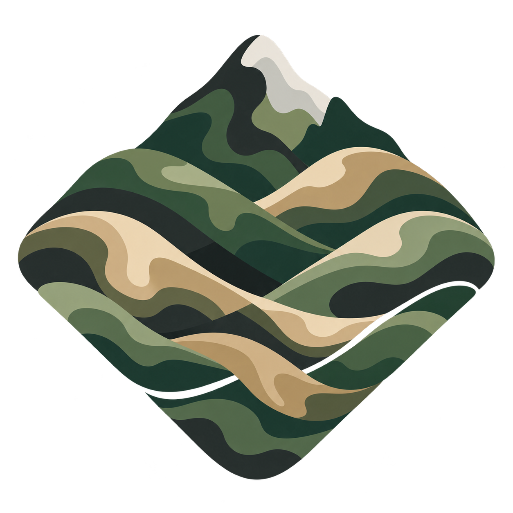
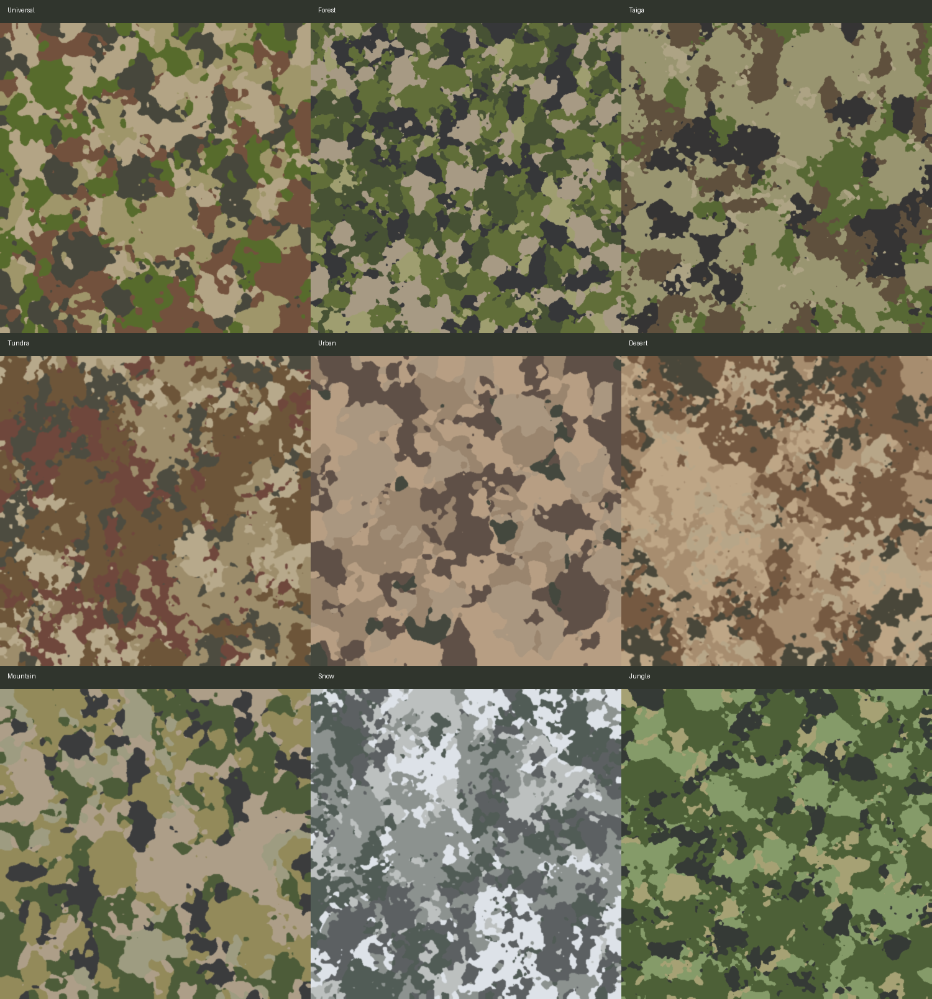

# TerrainWeave



TerrainWeave generates camouflage patterns from landscape photographs and
compares them in synthetic scenes.

**Play the web game: [fracarli.github.io/Camo_generator](https://fracarli.github.io/Camo_generator/)**

<a href="https://fracarli.github.io/Camo_generator/"></a>

Scan the code with a phone camera or open the link in any browser. Four one-minute games (Hunt, Duel, Flash, Squad) ask players to find
camouflaged figures; Squad hides four figures with different patterns in one
photo and ranks them by discovery order in each environment. Each anonymous round compares the TerrainWeave patterns with a plain
olive control and feeds the next optimization cycle. See the
[game guide](docs/GAME.md) for building, hosting, analysis and the
LinkedIn carousel and video generator.

## How it works

1. **Read the photos.** The generator groups reference images by environment
   and measures their colors, brightness and texture. The optional SegFormer
   model labels regions in the input photos so areas such as sky and water can
   be excluded from the analysis.
2. **Generate a pattern.** For each group, the generator builds a limited
   palette, renders several variations with a fixed seed and saves the best
   match by its image statistics. Each group gets a PNG, a palette preview and
   a JSON report.
3. **Compare versions.** The experiment pipeline splits the corpus first.
   It generates the baseline and optimizes candidates using the training
   photos, then renders both versions on the same held-out backgrounds at
   matching positions and scales. The reports record a visual contrast score
   for each synthetic scene. Field performance remains untested.

An environment-specific pattern uses references from one group, such as
`forest`. The experimental `universal` profile combines the available
non-snow groups into a single fixed pattern. With forest and desert references,
for example, the generator can produce separate forest and desert patterns
plus one mixed pattern with its own PNG.

## Getting started

From the repository root with Python 3.10 or newer:

```bash
python3 -m venv .venv
source .venv/bin/activate
python -m pip install -e .
terrainweave demo
```

The demo uses the included photographs and writes
`output/demo/all_patterns_grid.png`. For an interactive upload interface, see
[Studio](docs/WORKFLOWS.md#optional-dependencies). To use your own photographs
from the CLI:

```bash
terrainweave generate --input /path/to/photos --mode standard --colors 5 \
  --summary-groups universal --output output/my_patterns
```

Use [environment subfolders](docs/DATA_AND_LICENSES.md#local-reference-photos)
to organize multiple environments. Set `--summary-groups` to the groups you
want in the grid, for example `snow` for a folder of snow references. The
command also writes each generated group's pattern and report under the
chosen output directory.

## Experiments and examples

Run `terrainweave pipeline --skip-neural` to generate and compare the
procedural versions on held-out photographs. The [workflow guide](docs/WORKFLOWS.md)
lists the outputs and explains how to run the optional neural stage. The [web game](docs/GAME.md) collects public
feedback on the patterns through four short browser games. The
[observer-test protocol](docs/HUMAN_TEST_PROTOCOL.md) covers the offline test
and the bilingual web server.



See the [uniform mockups](results/optimized_mockups/outfit_contact_sheet.png),
[example scenes](results/optimized_validation/forest_contact_sheet.png),
[published reports](results/README.md) and
[project presentation](docs/presentation/overview.md).

## Repository layout

| Path | Contents |
|---|---|
| [src/terrainweave/](src/terrainweave/) | Application code, CLI and packaged assets |
| [configs/](configs/) | Reproducible configurations |
| [evaluation/](evaluation/) | Public photographs, provenance, splits and web-test scenes |
| [results/](results/README.md) | Selected historical results |
| [tests/](tests/) | Automated tests |
| [docs/](docs/README.md) | Workflows, architecture, data, human-test and web-game documentation |
| `output/` | Local run outputs, ignored by Git |

Use `terrainweave --help` for commands and
[architecture and verification](docs/ARCHITECTURE.md) for development.
