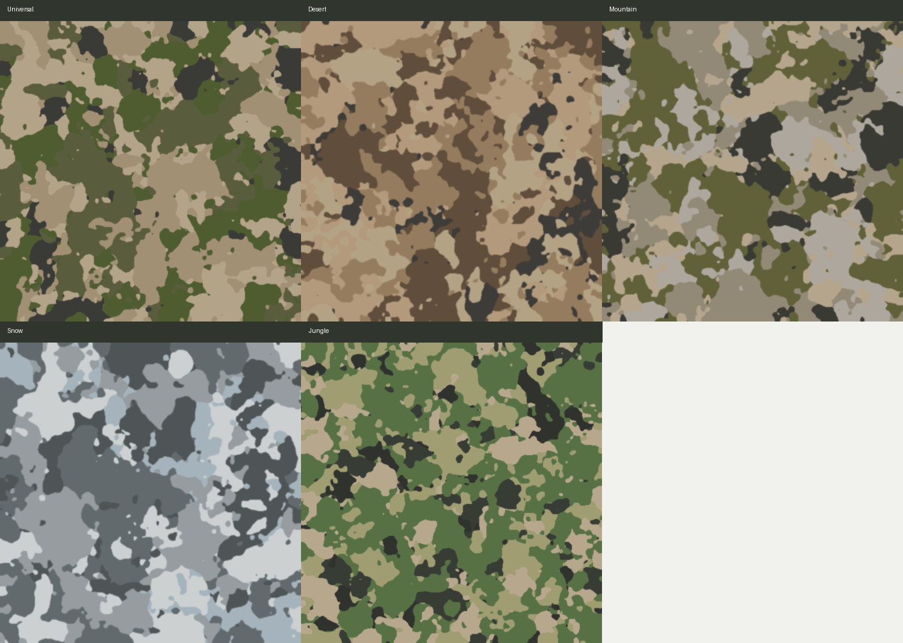
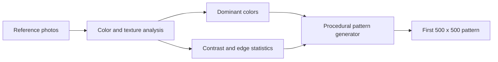
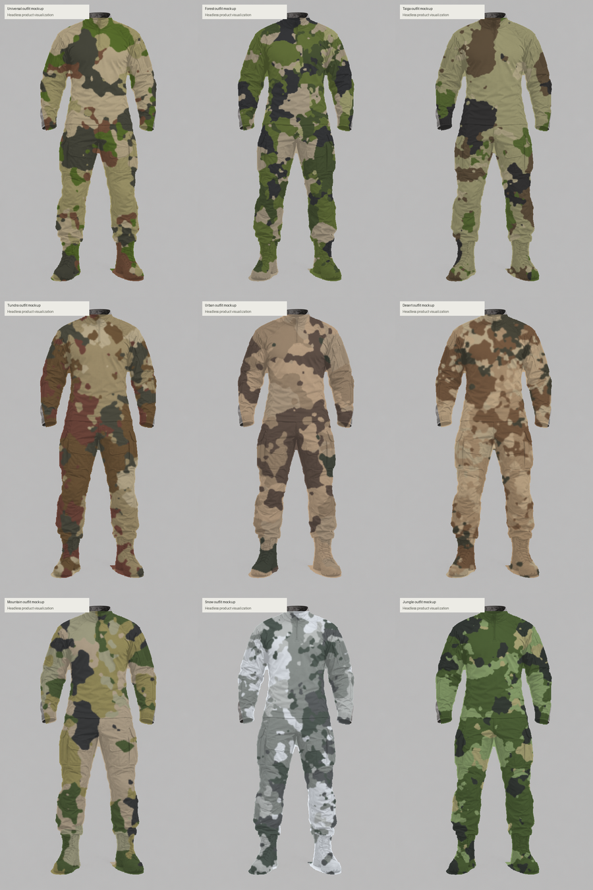
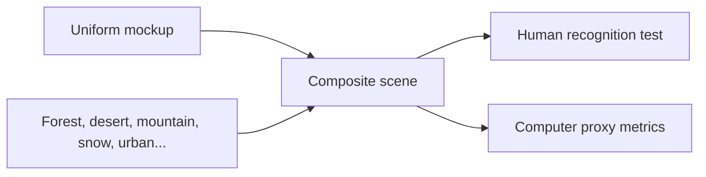
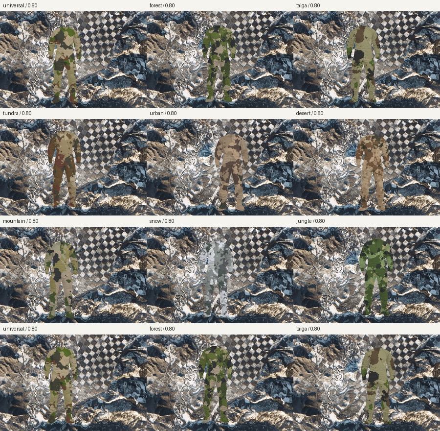
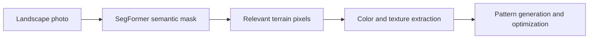

# Camo — Project Overview

Short English presentation for a live demo or an informal project introduction.

The computer-readable PDF version is available as
[PROJECT_PRESENTATION.pdf](./PROJECT_PRESENTATION.pdf). Regenerate it with
`python scripts/create_presentation_pdf.py` after updating the result images.

---

## Slide 1 — The idea

### Can a camouflage pattern be designed from the places where it will be used?

**Input:** a small collection of landscape photographs.

**Output:** a limited-color camouflage pattern designed to reduce visual
similarity to the selected environments.

The project is an explainable research prototype. It is not a certified
military pattern and it does not claim guaranteed real-world concealment.



---

## Slide 2 — From photographs to a first pattern



1. Collect representative photos for one environment.
2. Exclude irrelevant regions when possible, such as sky or water.
3. Extract dominant colors, luminance, local contrast, and texture cues.
4. Generate a finite-palette pattern with connected, irregular regions.

The first version is intentionally transparent: every decision can be inspected
in a report instead of being hidden inside an end-to-end black box.

---

## Slide 3 — Put the pattern on a human figure

The generated pattern is applied to a headless combat-uniform mockup. The goal
is not to create a fashion render; it is to test whether the pattern remains
plausible when it follows a body, folds, seams, and different garment pieces.



This step exposes problems that are difficult to see in a flat square:

- patches that are too large;
- excessive dark or bright colors;
- repetitive edges and visible stripes;
- a pattern that works only at one scale.

---

## Slide 4 — Place the figure inside real environments



The same figure can be placed at different positions and scales over suitable
background regions. The current human test uses randomized locations and short
exposure times to measure how quickly observers notice the figure.

The test is more meaningful when the figure is placed on terrain rather than
in obvious sky or water regions.



---

## Slide 5 — Improve the pattern from the evidence

The optimizer evaluates candidate patterns against several objectives:

- color similarity to the target scenes;
- luminance compatibility;
- local edge and contrast behavior;
- estimated figure visibility;
- balance across multiple images, rather than overfitting one photograph.

The best candidate is selected using a weighted score. The human-test CSV files
are complementary evidence: they help check whether the computer proxy agrees
with human perception.

This is an iterative loop:

```text
photos → initial pattern → human/computer evaluation → adjusted pattern
                                      ↑                         ↓
                                      └────── repeat ───────────┘
```

---

## Slide 6 — Where the neural network fits

The project currently uses a pretrained semantic-segmentation model,
SegFormer, as an optional input-analysis tool.

It helps identify scene regions such as vegetation, terrain, sky, and water so
that irrelevant pixels can be down-weighted or excluded. It does **not** train
a new camouflage generator, and it does **not** prove that the final pattern is
effective in the real world.



The current neural smoke-test outputs, including saved masks, are available in
`output/results_neural_smoke/`.

---

## Slide 7 — Current status and next step

### Working today

- nine environment profiles;
- verified evaluation corpus with 80 documented images;
- standard generation and weighted optimization;
- optional neural segmentation;
- uniform mockups and blinded human testing;
- reproducible JSON configurations and automated tests.

### Important limitation

This is a visual research prototype. The scores are proxy metrics and should
not be presented as proof of operational concealment.

### Next technical milestone

Build a larger, better-balanced dataset and train a learned ranking model from
human recognition data. Keep the current procedural generator as a transparent
baseline for comparison.

---

## Suggested live demo

1. Show this presentation and the generated pattern grid.
2. Open one pattern report and one uniform mockup.
3. Show a validation scene with the figure over a background.
4. Run `python scripts/verify_project.py`.
5. Explain that the neural model improves scene understanding, while the
   generator and optimizer still produce the pattern.
